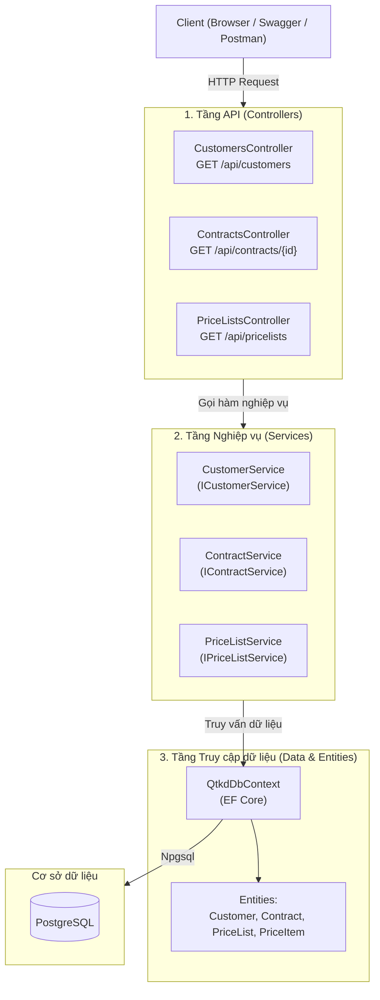
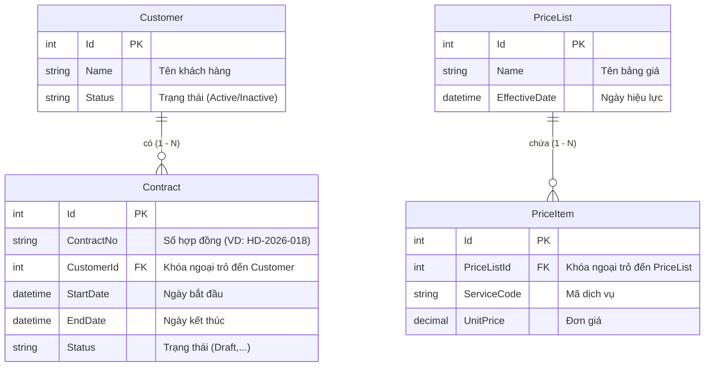

# BÀI THỰC HÀNH TUẦN 05 - XÂY DỰNG NỀN TẢNG HỆ THỐNG QTKD
**Môn học:** Phát triển ứng dụng Hệ thống thông tin hiện đại  
**Giai đoạn:** Phase 2 - Xây dựng hệ thống QTKD (Quản lý Kinh doanh)  
**Công nghệ sử dụng:** C# · .NET (ASP.NET Core Web API) · Entity Framework Core · PostgreSQL · Swagger  

---

## 1. Giới thiệu tổng quan
Bài thực hành Tuần 05 tập trung vào việc tạo lập nền tảng kiến trúc cho hệ thống Quản lý Kinh doanh (QTKD):
- Khởi tạo solution và project ASP.NET Core Web API có phân tầng rõ ràng (API, Nghiệp vụ, Truy cập dữ liệu).
- Định nghĩa các thực thể cốt lõi: `Customer`, `Contract`, `PriceList`, `PriceItem` và các mối quan hệ (1 - N).
- Cấu hình Entity Framework Core kết nối PostgreSQL.
- Tạo Migration (`InitialCreate`) và nạp dữ liệu mẫu ban đầu (Seed Data).
- Xây dựng các API cơ bản để đọc dữ liệu: `GET /api/customers`, `GET /api/contracts/{id}`, `GET /api/pricelists`.

---

## 2. Sơ đồ kiến trúc & Thành phần của Solution

### 2.1. Phân tầng kiến trúc (3-Layer Architecture cơ bản)
Dự án được tổ chức rõ ràng theo nguyên tắc cơ bản, dễ hiểu cho người mới học nhưng vẫn đảm bảo tính độc lập giữa các tầng:



### 2.2. Chi tiết cấu trúc thư mục
```
23120241_TH5/
├── QTKD.sln                       # Solution chứa dự án
├── docker-compose.yml             # File chạy nhanh PostgreSQL qua Docker (tùy chọn)
├── README.md                      # Hướng dẫn chi tiết
└── QTKD.Api/                      # Project ASP.NET Core Web API
    ├── Controllers/               # [Tầng API] Tiếp nhận HTTP Request và phản hồi HTTP Response
    │   ├── CustomersController.cs
    │   ├── ContractsController.cs
    │   └── PriceListsController.cs
    ├── Services/                  # [Tầng Nghiệp vụ] Xử lý logic và nghiệp vụ
    │   ├── ICustomerService.cs & CustomerService.cs
    │   ├── IContractService.cs & ContractService.cs
    │   └── IPriceListService.cs & PriceListService.cs
    ├── Data/                      # [Tầng Dữ liệu] DbContext và cấu hình EF Core
    │   └── QtkdDbContext.cs
    ├── Entities/                  # [Mô hình dữ liệu] Các thực thể (Models)
    │   ├── Customer.cs
    │   ├── Contract.cs
    │   ├── PriceList.cs
    │   └── PriceItem.cs
    ├── DTOs/                      # Data Transfer Objects trao đổi qua API
    │   ├── CustomerDto.cs
    │   ├── ContractDto.cs
    │   └── PriceListDto.cs
    ├── Migrations/                # EF Core Migration tự động sinh
    │   └── ..._InitialCreate.cs
    ├── appsettings.json           # Cấu hình chuỗi kết nối PostgreSQL
    ├── appsettings.Example.json   # Bản mẫu cấu hình (không chứa mật khẩu thật)
    ├── Program.cs                 # Điểm khởi chạy ứng dụng & Dependency Injection
    └── QTKD.Api.http              # File test nhanh API bằng REST Client
```

---

## 3. Mô hình dữ liệu & Quan hệ thực thể (ERD)



---

## 4. Dữ liệu mẫu ban đầu (Seed Data)
Được cấu hình tự động trong Migration `InitialCreate` theo sát kịch bản đề bài:
1. **Khách hàng (Customer):**
   - `Id = 1`: Tên *"Công ty TNHH Minh Phát"*, Trạng thái: `Active`.
   - `Id = 2`: Tên *"Công ty Cổ phần Hoàng Gia"*, Trạng thái: `Active`.
2. **Hợp đồng (Contract):**
   - `Id = 1`: Số hợp đồng *"HD-2026-018"*, `CustomerId = 1` (Minh Phát), `StartDate = 2026-03-01`, `EndDate = 2027-03-01`, Trạng thái: `Draft`.
3. **Bảng giá (PriceList & PriceItem):**
   - Bảng giá `Id = 1`: *"Bảng giá dịch vụ phần mềm 2026"*, Ngày hiệu lực: `2026-01-01`.
   - Mục giá 1: Mã dịch vụ `SRV-CLOUD`, Đơn giá: `1.500.000 VNĐ`.
   - Mục giá 2: Mã dịch vụ `SRV-SUPPORT`, Đơn giá: `500.000 VNĐ`.

---

## 5. Hướng dẫn cài đặt và chạy ứng dụng

### Bước 1: Khởi động cơ sở dữ liệu PostgreSQL
Có 2 cách:
- **Cách A (Dùng Docker Compose - Tiện lợi nhất):**
  Tại thư mục gốc dự án, mở terminal chạy:
  ```bash
  docker compose up -d
  ```
- **Cách B (Dùng PostgreSQL cài trực tiếp trên máy):**
  Tạo sẵn một database tên là `qtkd_db` trong PostgreSQL:
  ```sql
  CREATE DATABASE qtkd_db;
  ```

### Bước 2: Cấu hình chuỗi kết nối
Mở file [appsettings.json](file:///d:/download/23120241_TH5/QTKD.Api/appsettings.json), chỉnh sửa thông tin đăng nhập PostgreSQL cho phù hợp với máy của bạn:
```json
{
  "ConnectionStrings": {
    "DefaultConnection": "Host=localhost;Port=5433;Database=qtkd_db;Username=postgres;Password=postgres"
  }
}
```
> **Lưu ý bảo mật:** Dự án đã có file `appsettings.Example.json` làm mẫu. Khi đẩy mã nguồn lên Git công khai, tránh đưa mật khẩu thực tế lên repository.

### Bước 3: Chạy Migration để tạo bảng và dữ liệu mẫu
Mở terminal tại thư mục gốc dự án và thực hiện lệnh:
```bash
dotnet ef database update --project QTKD.Api
```
EF Core sẽ tự động kết nối vào PostgreSQL, tạo các bảng `Customers`, `Contracts`, `PriceLists`, `PriceItems` cùng các ràng buộc khóa chính/khóa ngoại và nạp dữ liệu mẫu ban đầu.

### Bước 4: Khởi động Web API
Chạy lệnh:
```bash
dotnet run --project QTKD.Api
```
Khi ứng dụng khởi động thành công, giao diện Swagger UI sẽ sẵn sàng tại:
`https://localhost:<port>/swagger` (hoặc `http://localhost:<port>/swagger`).

---

## 6. Kiểm tra các Endpoint API

### 6.1. Endpoint 1: Lấy danh sách khách hàng
- **Phương thức:** `GET`
- **URL:** `http://localhost:<port>/api/customers`
- **Kết quả JSON mẫu:**
```json
[
  {
    "id": 1,
    "name": "Công ty TNHH Minh Phát",
    "status": "Active"
  },
  {
    "id": 2,
    "name": "Công ty Cổ phần Hoàng Gia",
    "status": "Active"
  }
]
```

### 6.2. Endpoint 2: Lấy chi tiết hợp đồng theo Id
- **Phương thức:** `GET`
- **URL:** `http://localhost:<port>/api/contracts/1`
- **Kết quả JSON mẫu:**
```json
{
  "id": 1,
  "contractNo": "HD-2026-018",
  "customerId": 1,
  "customerName": "Công ty TNHH Minh Phát",
  "startDate": "2026-03-01T00:00:00Z",
  "endDate": "2027-03-01T00:00:00Z",
  "status": "Draft"
}
```
*(Nếu gọi với Id không tồn tại, ví dụ `/api/contracts/999`, API sẽ trả về `404 Not Found` kèm thông báo).*

### 6.3. Endpoint phụ: Lấy danh sách bảng giá và chi tiết giá
- **Phương thức:** `GET`
- **URL:** `http://localhost:<port>/api/pricelists`
- **Kết quả JSON mẫu:**
```json
[
  {
    "id": 1,
    "name": "Bảng giá dịch vụ phần mềm 2026",
    "effectiveDate": "2026-01-01T00:00:00Z",
    "items": [
      {
        "id": 1,
        "serviceCode": "SRV-CLOUD",
        "unitPrice": 1500000.00
      },
      {
        "id": 2,
        "serviceCode": "SRV-SUPPORT",
        "unitPrice": 500000.00
      }
    ]
  }
]
```

---

## 7. Đối chiếu kết quả với dữ liệu trong PostgreSQL
Bạn có thể mở công cụ quản lý PostgreSQL (pgAdmin / DBeaver / psql) và chạy các câu lệnh sau để đối chiếu dữ liệu:

```sql
-- 1. Xem danh sách khách hàng
SELECT * FROM "Customers";

-- 2. Xem danh sách hợp đồng
SELECT c."Id", c."ContractNo", c."Status", cust."Name" AS "CustomerName"
FROM "Contracts" c
JOIN "Customers" cust ON c."CustomerId" = cust."Id";

-- 3. Xem bảng giá và các mục giá
SELECT pl."Name", pi."ServiceCode", pi."UnitPrice"
FROM "PriceLists" pl
JOIN "PriceItems" pi ON pl."Id" = pi."PriceListId";
```

Kết quả trả về từ database hoàn toàn khớp với kết quả từ các API endpoints!

---

## 8. Danh mục nghiệm thu nộp bài Tuần 05
- [x] Tạo solution `QTKD` và project `QTKD.Api` với cấu trúc phân tầng rõ ràng (API, Nghiệp vụ, Truy cập dữ liệu).
- [x] Tạo đầy đủ các entity: `Customer`, `Contract`, `PriceList`, `PriceItem` với quan hệ 1-N.
- [x] Cấu hình `QtkdDbContext` và chuỗi kết nối PostgreSQL.
- [x] Tạo Migration đầu tiên (`InitialCreate`) và Seed Data mẫu đúng theo kịch bản xuyên suốt (Công ty Minh Phát, Hợp đồng HD-2026-018 ở trạng thái Draft, Bảng giá có 2 mục giá).
- [x] Viết đầy đủ API: `GET /api/customers` và `GET /api/contracts/{id}`.
- [x] Tích hợp Swagger UI hỗ trợ chạy thử và kiểm tra trực quan.
- [x] Viết tài liệu `README.md` hướng dẫn chi tiết từ A-Z và sơ đồ kiến trúc.
