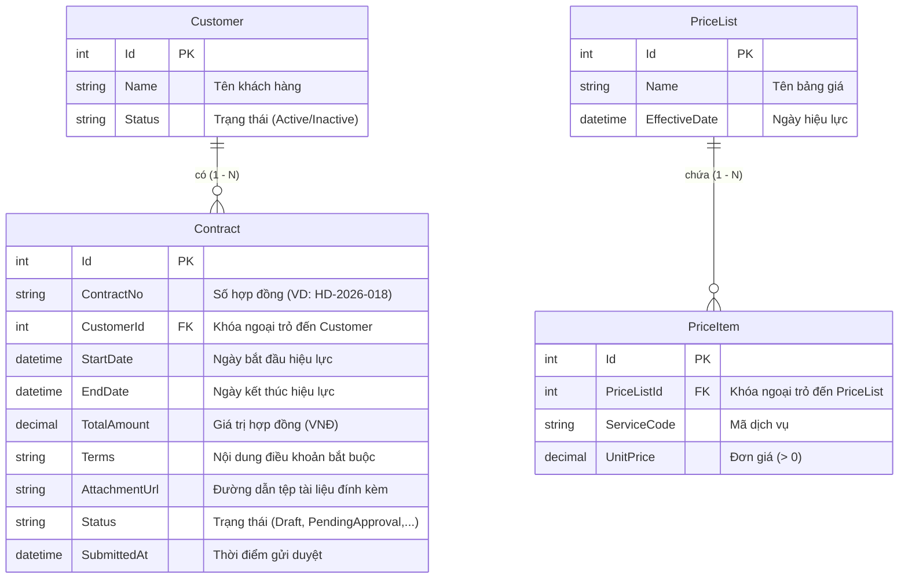

# HỆ THỐNG QUẢN LÝ KINH DOANH (QTKD) - PHASE 2

**Môn học:** Phát triển ứng dụng Hệ thống thông tin hiện đại  
**Sinh viên thực hiện:** Dương Việt Dũng - MSSV: 23120241  
**GitHub Repository:** [Duong-Dung/QTKD_23120241](https://github.com/Duong-Dung/QTKD_23120241)  
**Công nghệ:** C# · ASP.NET Core Web API 10 · Entity Framework Core · PostgreSQL · Swagger  

---

## 1. Giới thiệu tổng quan tiến độ các tuần

| Tuần | Công việc chính | Trạng thái | Kết quả đạt được |
|:---:|---|:---:|---|
| **05** | Tạo dự án, cơ sở dữ liệu và API đọc dữ liệu | **Đã hoàn thành** | Khởi tạo Solution, cấu hình EF Core kết nối PostgreSQL, Seed Data (`Customer`, `Contract`, `PriceList`), viết các API đọc dữ liệu cơ bản. |
| **06** | Viết các chức năng và kiểm tra quy tắc nghiệp vụ | **Đã hoàn thành** | Hoàn thiện CRUD Customer, Contract, Pricing; Lập trình kỹ lưỡng US03 (Gửi duyệt hợp đồng); Kiểm tra nghiêm ngặt CTR-01, CTR-02, CTR-03 và chống gửi trùng lặp (Yêu cầu 12). |
| **07** | Viết kiểm thử (Unit test & Integration test) | *Sắp tới* | Viết bộ kiểm thử tự động xUnit cho CTR-01, CTR-02, CTR-03 và tích hợp API. |

---

## 2. Các tính năng và quy tắc nghiệp vụ hoàn thành trong Tuần 06

### 2.1. Quản lý Khách hàng (Customer)
- **API hỗ trợ:**
  - `GET /api/customers`: Lấy danh sách tất cả khách hàng.
  - `GET /api/customers/{id}`: Lấy thông tin chi tiết một khách hàng.
  - `POST /api/customers`: Tạo khách hàng mới (kiểm tra bắt buộc tên, trạng thái mặc định `Active`).
  - `PUT /api/customers/{id}`: Cập nhật thông tin khách hàng.

### 2.2. Quản lý Bảng giá & Mục giá (Pricing)
- **API hỗ trợ:**
  - `GET /api/pricelists`: Xem danh sách bảng giá và các mục giá.
  - `GET /api/pricelists/{id}`: Xem chi tiết bảng giá theo Id.
  - `POST /api/pricelists`: Tạo bảng giá mới.
  - `POST /api/pricelists/{id}/items`: Thêm mục giá dịch vụ vào bảng giá (kiểm tra đơn giá `UnitPrice > 0`, bảng giá phải tồn tại).
  - `GET /api/pricelists/{id}/items`: Lấy danh sách các mục giá thuộc bảng giá.

### 2.3. Quản lý Hợp đồng & Xử lý nghiệp vụ chuyên sâu (Contract & US03)
- **API hỗ trợ:**
  - `GET /api/contracts`: Lấy danh sách hợp đồng.
  - `GET /api/contracts/{id}`: Lấy chi tiết hợp đồng theo Id.
  - `POST /api/contracts`: Tạo hợp đồng mới ở trạng thái `Draft` (kiểm tra ngày hiệu lực `StartDate < EndDate`, không trùng số hợp đồng).
  - `PUT /api/contracts/{id}`: Cập nhật thông tin hợp đồng (**Tuân thủ CTR-01**).
  - `POST /api/contracts/{id}/submit`: Gửi hợp đồng trình duyệt (**User Story US03 / CTR-01, 02, 03**).

### 2.4. Bảng đối chiếu các quy tắc nghiệp vụ cốt lõi

| Mã quy tắc | Ý nghĩa nghiệp vụ | Cách kiểm tra trong hệ thống | Kết quả xử lý |
|---|---|---|---|
| **CTR-01** | Chỉ cho phép chỉnh sửa hợp đồng khi ở trạng thái `Draft` hoặc `Revision Requested`. | Thử gửi `PUT /api/contracts/{id}` khi hợp đồng ở trạng thái `PendingApproval`. | Trả về `400 Bad Request`, từ chối chỉnh sửa và bảo vệ dữ liệu. |
| **CTR-02** | Chỉ cho gửi trình duyệt khi Customer hợp lệ (`Active`), ngày hiệu lực hợp lệ, nội dung điều khoản (`Terms`) và tệp tài liệu đính kèm (`AttachmentUrl`) đầy đủ, giá trị `TotalAmount > 0`. | Gửi `POST /api/contracts/{id}/submit` khi hợp đồng thiếu tệp đính kèm hoặc `TotalAmount = 0`. | Trả về `400 Bad Request` kèm danh sách lỗi cụ thể; trạng thái hợp đồng vẫn giữ nguyên là `Draft`. |
| **CTR-03** | Không được chuyển `Draft` thẳng sang `Approved`. | Khi gửi trình duyệt hợp lệ qua `POST /api/contracts/{id}/submit`. | Trạng thái chỉ được chuyển sang `PendingApproval`. Không có API nào cho phép nhảy cóc sang `Approved`. |
| **Yêu cầu 12** | Ngăn chặn gửi trình duyệt trùng lặp (Idempotency). | Gửi `POST /api/contracts/{id}/submit` lần thứ hai khi hợp đồng đã ở `PendingApproval`. | Trả về `400 Bad Request` thông báo hợp đồng đã được trình duyệt trước đó. |

---

## 3. Kiến trúc hệ thống & Cấu trúc thư mục

### 3.1. Phân tầng kiến trúc
Dự án được tổ chức theo mô hình phân tầng hướng đối tượng chuẩn ASP.NET Core:
1. **Tầng API (Controllers):** `CustomersController`, `ContractsController`, `PriceListsController` tiếp nhận HTTP request, validate Model và định dạng phản hồi chuẩn qua `ApiResponse<T>`.
2. **Tầng Nghiệp vụ (Services):** `CustomerService`, `ContractService`, `PriceListService` kiểm tra toàn bộ business rules (CTR-01, CTR-02, CTR-03).
3. **Tầng Dữ liệu (Data & Entities):** `QtkdDbContext` sử dụng Entity Framework Core kết nối PostgreSQL.

### 3.2. Cấu trúc thư mục dự án
```
23120241_TH6/
├── QTKD.sln                               # Visual Studio / .NET Solution
├── docker-compose.yml                     # Cấu hình PostgreSQL chạy container
├── README.md                              # Hướng dẫn tổng quan & báo cáo thực hành
├── docs/                                  # Tài liệu chi tiết theo quy định nộp bài
│   ├── API_DOCUMENTATION.md               # Tài liệu chi tiết toàn bộ Endpoint, Request/Response mẫu
│   ├── BUSINESS_RULES_MAPPING.md          # Bảng đối chiếu US03, CTR-01, CTR-02, CTR-03 với code
│   └── DEMO_SCENARIO.md                   # Kịch bản thực hiện từng bước luồng demo tuần 06
└── QTKD.Api/                              # Dự án ASP.NET Core Web API
    ├── Controllers/                       # [API Layer]
    │   ├── CustomersController.cs
    │   ├── ContractsController.cs
    │   └── PriceListsController.cs
    ├── Services/                          # [Business Logic Layer]
    │   ├── ICustomerService.cs & CustomerService.cs
    │   ├── IContractService.cs & ContractService.cs
    │   └── IPriceListService.cs & PriceListService.cs
    ├── Data/                              # [Data Access Layer]
    │   └── QtkdDbContext.cs
    ├── Entities/                          # [Domain Models]
    │   ├── Customer.cs
    │   ├── Contract.cs                    # Bổ sung TotalAmount, Terms, AttachmentUrl, SubmittedAt
    │   ├── PriceList.cs
    │   └── PriceItem.cs
    ├── DTOs/                              # [Data Transfer Objects & API Response Wrapper]
    │   ├── ApiResponse.cs                 # Mẫu chuẩn hóa kết quả phản hồi API
    │   ├── CustomerDto.cs
    │   ├── ContractDto.cs
    │   └── PriceListDto.cs
    ├── Exceptions/                        # [Ngoại lệ nghiệp vụ]
    │   └── BusinessRuleException.cs
    ├── Migrations/                        # [EF Core Migrations]
    │   ├── 20261027030137_InitialCreate.cs
    │   └── 20261103133532_AddContractFieldsForWeek06.cs   # Migration bổ sung Tuần 06
    ├── appsettings.json                   # Cấu hình kết nối DB
    ├── appsettings.Example.json           # Cấu hình mẫu an toàn
    ├── Program.cs                         # Điểm vào ứng dụng & DI
    └── QTKD.Api.http                      # Bộ kịch bản kiểm thử API trực tiếp
```

---

## 4. Mô hình dữ liệu cập nhật (ERD)



---

## 5. Hướng dẫn cài đặt và chạy ứng dụng

### Bước 1: Khởi động cơ sở dữ liệu PostgreSQL
- Nếu dùng Docker Compose:
  ```bash
  docker compose up -d
  ```
- Hoặc kết nối tới máy chủ PostgreSQL nội bộ trên cổng phù hợp (mặc định cấu hình cổng 5432 hoặc 5433 trong `appsettings.json`).

### Bước 2: Áp dụng Migration cập nhật cơ sở dữ liệu
Tại thư mục gốc dự án, thực hiện lệnh:
```bash
dotnet ef database update --project QTKD.Api
```
Lệnh này sẽ tự động chạy cả `InitialCreate` và `AddContractFieldsForWeek06`, tạo đầy đủ các bảng, các cột mới và nạp dữ liệu mẫu ban đầu.

### Bước 3: Khởi động Web API
```bash
dotnet run --project QTKD.Api
```
Sau khi khởi động, truy cập giao diện Swagger UI trực quan tại:
`http://localhost:5293/swagger` (hoặc cổng được hiển thị trên console).

---

## 6. Hướng dẫn chạy thử Luồng Demo Tuần 06 (Mục 4.3 - Bước 13)

Để thực hiện kiểm tra luồng xuyên suốt đề bài yêu cầu:
1. Mở file [QTKD.Api/QTKD.Api.http](file:///d:/download/23120241_TH6/QTKD.Api/QTKD.Api.http) trên VS Code hoặc truy cập giao diện Swagger UI.
2. Thực hiện lần lượt 6 bước theo kịch bản:
   - **Bước 1 (Tạo Customer):** Gửi `POST /api/customers` để tạo khách hàng mới.
   - **Bước 2 (Tạo Contract Draft):** Gửi `POST /api/contracts` tạo hợp đồng còn thiếu tài liệu và giá trị.
   - **Bước 3 (Gửi khi thiếu dữ liệu):** Gửi `POST /api/contracts/{id}/submit` -> Hệ thống báo lỗi HTTP `400 Bad Request` do vi phạm CTR-02 (thiếu tệp đính kèm và giá trị <= 0), hợp đồng vẫn giữ nguyên trạng thái `Draft`.
   - **Bước 4 (Bổ sung dữ liệu):** Gửi `PUT /api/contracts/{id}` bổ sung `totalAmount`, `terms`, `attachmentUrl` -> Hệ thống trả về `200 OK` cập nhật thành công (CTR-01).
   - **Bước 5 (Gửi lại thành công):** Gửi `POST /api/contracts/{id}/submit` -> Hệ thống trả về `200 OK`, chuyển trạng thái sang `PendingApproval` (CTR-03).
   - **Bước 6 (Xem trạng thái):** Gửi `GET /api/contracts/{id}` xác nhận trạng thái là `PendingApproval` và có `submittedAt`.
3. Kiểm tra thêm các tình huống bảo vệ:
   - Thử sửa hợp đồng vừa chuyển sang `PendingApproval` -> Bị chặn bởi CTR-01.
   - Thử gửi duyệt lại hợp đồng vừa chuyển sang `PendingApproval` -> Bị chặn bởi cơ chế chống gửi lặp (Yêu cầu 12).

*(Xem hướng dẫn chi tiết tại [docs/DEMO_SCENARIO.md](file:///d:/download/23120241_TH6/docs/DEMO_SCENARIO.md))*.

---

## 7. Danh mục nghiệm thu nộp bài Tuần 06
- [x] Kế thừa toàn bộ cơ sở dữ liệu và mã nguồn Tuần 05.
- [x] Tạo Migration bổ sung `AddContractFieldsForWeek06` cho thực thể Contract.
- [x] Viết đầy đủ các API CRUD cho Customer, Contract và Pricing.
- [x] Cài đặt hoàn chỉnh User Story US03 (`POST /api/contracts/{id}/submit`).
- [x] Kiểm tra và bảo vệ nghiêm ngặt quy tắc CTR-01 (chỉ sửa ở Draft/Revision Requested).
- [x] Kiểm tra và bảo vệ nghiêm ngặt quy tắc CTR-02 (kiểm tra Customer Active, ngày hiệu lực, terms, tệp đính kèm, totalAmount).
- [x] Đảm bảo tuân thủ CTR-03 (không chuyển thẳng từ Draft sang Approved, chỉ chuyển sang PendingApproval).
- [x] Xử lý chống gửi duyệt trùng lặp (Yêu cầu 12).
- [x] Thống nhất định dạng phản hồi API qua `ApiResponse<T>`.
- [x] Cập nhật bộ test nhanh trong file `QTKD.Api.http`.
- [x] Bố trí thư mục `docs/` chứa tài liệu API, bảng đối chiếu quy tắc nghiệp vụ và kịch bản demo theo đúng chuẩn nộp bài.
